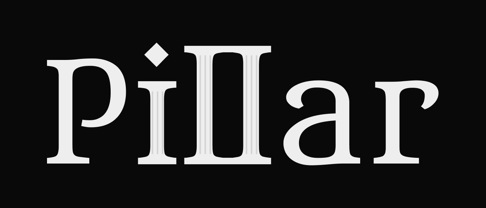

# Pillar

A statically typed language read **down columns, then across**. Pillar compiles to
native code with Cranelift and gives its vertical source ordinary language tools:
checking, formatting, modules, diagnostics, navigation and a horizontal preview.

This is **2.0.0-alpha.1**, a breaking development version of the original experiment.
Read [the language reference](docs/LANGUAGE.md), [CLI guide](docs/CLI.md),
[migration notes](docs/MIGRATION.md) and [implementation status](docs/ROADMAP.md).

## Build and try

Install Rust with rustup and a native C toolchain. The repository selects Rust
1.99.1 automatically; the minimum supported Rust version is 1.97.

- macOS: Xcode Command Line Tools (`xcode-select --install`).
- Linux: GCC or Clang and the system C development libraries; `mold` is optional.
- Windows: Visual Studio C++ Build Tools with the Windows SDK. This release targets
  **MSVC**, so use the MSVC toolchain rather than MinGW.

```sh
cargo build --locked --bin plrc
cargo run --locked -- run examples/hello.plr
cargo run --locked -- check examples/modules/main.plr
cargo run --locked -- fmt examples/hello.plr --check
cargo test --all-targets --locked
```

To install locally, use `cargo install --path . --locked`. Tested native release
archives include the compiler, embedded runtime, documentation, examples and shell
completions. Rust is needed to build the compiler from source; the native linker
is still needed to build Pillar programs. No `runtime.o` in the working directory
is required.

## Write and run

The following is the horizontal **view** of a program:

```text
FN main(): int
{
  LT name: str = "Pillar"~
  println("Hello, " + name + "!")~
  RET 0~
}
```

Import that view into a vertical `.plr` file, then run it:

```sh
plrc transpose examples/hello.rplr --from horizontal > hello.plr
plrc check hello.plr
plrc run hello.plr
plrc build hello.plr --release -o hello
```

`.plr` is authoritative; `.rplr` files are readable exported views, not a second
independently compiled source. Existing examples live in [examples](examples).
They include factorial, Fibonacci, an interactive guessing game, text-file
inspection, value-semantic collections and imports.
The largest example is [Pillar Chess](examples/chess): a seven-module chess engine
with legal moves, alpha-beta search, interactive play and a perft regression suite.

```sh
cargo run --locked -- run examples/chess/main.plr
```

## Tools

- `plrc check/build/run/fmt/transpose/completions`; `plrc lsp` serves UTF-16 LSP over stdio.
- [VS Code extension](editor/vscode): language tools, column operations and live preview.
- [Local playground](playground): two views and constrained Docker execution.
- [Validation guide](docs/VALIDATION.md): regression tests, sanitizers, packaging and benchmarks.

Native CI is configured for macOS ARM64/x86-64, Linux ARM64/x86-64 and Windows
x86-64. Public releases are gated on their native tests and extracted-archive smoke
tests. Cross-compilation of Pillar programs is not provided by this version.

## License

[MIT](LICENSE), copyright Nikita Zhulanov.
